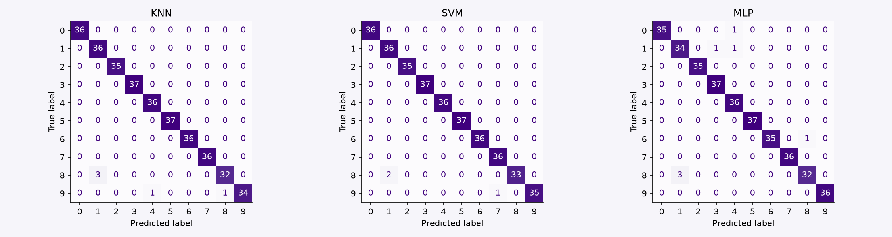
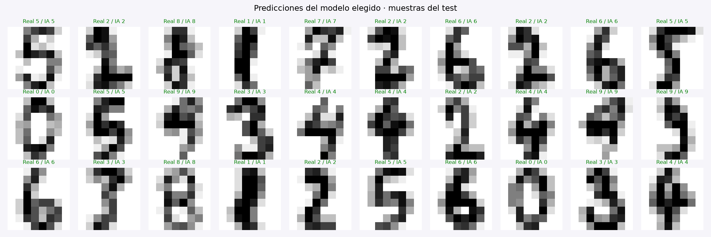
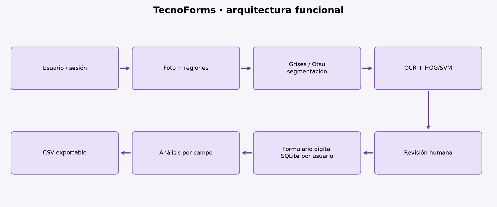

# TecnoForms: digitalización asistida de formularios manuscritos

**Trabajo final — Clasificación de Dígitos Manuscritos**  
**Fecha:** 5 de noviembre de 2026

## 1. Problema y objetivo

TecnoForms procesa formularios de inscripción, pagos y solicitudes cuyo contenido numérico se escribe a mano. La transcripción manual consume tiempo y puede introducir errores. El objetivo es convertir la foto de un formulario en campos digitales revisables, reconocer sus dígitos mediante aprendizaje automático y generar análisis por tipo de respuesta.

Se propone un flujo asistido por una persona. La aplicación no autoriza pagos ni determina calificaciones o admisiones. Su resultado es una propuesta de transcripción que el usuario revisa y confirma.

## 2. Solución implementada

La aplicación web permite crear una cuenta e iniciar sesión, responder un cuestionario inicial y ver una guía para principiantes en el primer ingreso. En el segundo acceso esa guía ya no aparece automáticamente. Siempre se puede consultar desde Cómo funciona.

El usuario sube una foto JPG, PNG o WEBP. Tesseract intenta detectar líneas, rótulos y respuestas legibles. Para las respuestas numéricas manuscritas se seleccionan regiones sobre la imagen y se asigna un nombre de campo. El sistema segmenta dígitos, calcula características HOG y propone los números con SVM. Los campos resultantes son editables; pueden añadirse respuestas manuales. Se exige confirmar la revisión para guardar.

Los formularios quedan asociados a la cuenta, pueden exportarse a CSV y alimentan un panel de análisis. Las estadísticas agrupan respuestas por nombre de campo, muestran cantidad, media, mínimo y máximo, y excluyen respuestas no numéricas y nombres comunes de identificadores. No se suman notas con pagos ni edades con otros datos.

La interfaz incluye identidad gráfica original, colores lima/lila/rosa sobre fondo oscuro, desenfoque decorativo, letras de estilo graffiti, animación de escaneo, stickers, emojis y diálogos flotantes. El contenido conserva contraste y el diseño se adapta a pantallas pequeñas; se respeta la preferencia de movimiento reducido.

## 3. Metodología y datos

**Benchmark académico:** UCI Optical Recognition of Handwritten Digits, distribuido en scikit-learn. Contiene 1 797 imágenes de 8×8 y clases 0 a 9. Se normalizan las intensidades 0–16 a 0–1. Se verifican faltantes, duplicados y distribución. La partición estratificada reserva 360 imágenes para test y 1 437 para entrenamiento, con semilla 42.

Se comparan KNN (k=3,5), SVM RBF (C=1,10) y MLP (alpha=0.0001,0.001). GridSearchCV usa 3 pliegues estratificados y F1 macro dentro del entrenamiento. Se selecciona por validación y después se reporta test. No se ajustan parámetros usando test.

**Motor de regiones:** MNIST, imágenes de 28×28. Se muestrean 15 000 ejemplos oficiales de entrenamiento con semilla 42. Se separan 3 000 para validar C=2 y C=8; se elige C=2 y se reentrena con las 15 000 muestras. La evaluación final usa las 10 000 imágenes oficiales de test. HOG produce 324 características. Este experimento se informa separado del benchmark UCI.

**Datos ficticios:** se generan 240 registros de formularios con cantidad de campos, calidad simulada y tiempo sintético. Una MLP adicional aprende una etiqueta ficticia de procesabilidad y se evalúa en test separado. La regresión lineal usa test separado para estimar tiempos; K-Means con escalado construye 3 grupos operativos. Son evidencias curriculares y no demuestran ahorros empresariales reales.

## 4. Preprocesamiento de imágenes

Se valida tamaño y resolución, aplica orientación EXIF y reduce la imagen manteniendo proporción. La aplicación ofrece giro manual. Las regiones numéricas se convierten a gris y se binarizan con Otsu. Se retiran fragmentos de líneas largas en los bordes; se detectan componentes conectados y se ordenan de izquierda a derecha. Cada recorte se escala conservando proporción, se coloca en una imagen de 28×28 y se centra por momentos de tinta; HOG transforma el patrón en características para SVM.

La calidad de captura es fundamental: hoja de frente, iluminación uniforme, buen enfoque y dígitos separados. No se implementó corrección automática de perspectiva. Trazos partidos o unidos pueden provocar segmentación incorrecta; letras y puntuación dentro de regiones numéricas pueden confundirse con números. Por eso la revisión siempre es obligatoria.

## 5. Red neuronal y funcionamiento interno

La MLP tiene 64 entradas, dos capas ocultas de 64 y 32 neuronas ReLU y salida de 10 clases softmax. Usa 6 570 parámetros, Adam, entropía cruzada multiclase, learning rate inicial de 0.001, regularización L2 y hasta 180 iteraciones. El cuaderno conserva advertencias de convergencia: alcanzar el máximo de iteraciones no demuestra convergencia y es un punto de mejora.

En propagación hacia adelante se calcula z=W·x+b y se aplica activación. Softmax normaliza la salida. La entropía cruzada penaliza discrepancias respecto a la etiqueta real; retropropagación obtiene gradientes y Adam actualiza los pesos. Validación y regularización ayudan a controlar sobreajuste. No se utiliza CNN; por tanto, el requisito condicional de capas convolucionales no corresponde a esta arquitectura. Una CNN queda como futura comparación con más datos del dominio.

## 6. Resultados medidos

|Modelo|Exactitud test UCI|
|---|---:|
|KNN|98.61%|
|SVM|99.17%|
|MLP|98.06%|

SVM se seleccionó por el mayor F1 de validación. El motor HOG/SVM obtuvo **99.04% en MNIST test oficial**. Las precisiones macro, recall, F1, parámetros, matrices de confusión y clasificación por clase están en los JSON de `models/` y en el cuaderno ejecutado. Los gráficos muestran predicciones y etiquetas reales de ejemplos separados de test.

Estas cifras pertenecen a **dígitos aislados estandarizados**. No son la exactitud de digitalización de un formulario completo ni de una fotografía nueva. El sistema aún no tiene un test empresarial independiente de formularios reales. No se usa la puntuación del modelo como garantía de corrección.

## 7. Preguntas guía

**1. ¿Qué desafíos producen la variabilidad de escritura y la calidad de imagen?** Cambian tamaño, inclinación, presión y trazado entre personas. Dígitos similares (1/7, 3/8, 4/9) pueden confundirse. Sombras, desenfoque, tablas, manchas y perspectiva dificultan segmentar. Un error de segmentación puede dividir un número en dos o unir varios. Deben medirse por separado localización, transcripción y cadena completa.

**2. ¿Cómo afecta la elección de algoritmo?** KNN es simple, depende de distancias y escala, y almacena ejemplos. SVM aprende fronteras no lineales y funciona bien con conjuntos moderados. MLP aprende características por pesos y requiere más cuidado con convergencia y regularización. En este experimento gana SVM por validación; eso no prueba superioridad universal. La elección debe considerar precisión por clase, tiempo y memoria.

**3. ¿Qué preprocesamiento es más efectivo?** Orientación, gris, binarización, supresión cuidadosa de líneas, recorte, conservación de proporción y centrado son útiles. Otsu funciona con iluminación uniforme; umbral adaptativo puede ayudar con sombras pero requiere validación. Un suavizado excesivo borra trazos finos. La corrección geométrica debe añadirse y probarse con fotos oblicuas.

**4. ¿Qué métricas deben considerarse e interpretarse?** Exactitud es la fracción total de aciertos. Precisión mide aciertos entre predicciones de una clase; recall, ejemplos recuperados de los reales; F1 equilibra ambos. La media macro evita que una clase abundante domine. La matriz localiza confusiones. En el producto deben añadirse exactitud por campo y formulario, tasa de correcciones, tiempo humano y cobertura de campos. La transcripción de un número completo puede fallar aunque la mayoría de sus dígitos sean correctos.

**5. ¿Cómo mejorar si la precisión no es aceptable?** Reunir fotos consentidas, distintas personas y dispositivos; etiquetar regiones; separar test por escritor/formulario; aumentar imágenes con sombras, ruido y geometría; probar CNN o HTR para texto libre; ajustar solo en validación; calibrar scores; incorporar revisión ante casos dudosos y versionar correcciones verificadas. Repetir evaluación independiente antes de sustituir un modelo.

## 8. Arquitectura, factibilidad y plan de validación

Flask recibe solicitudes, verifica sesión y token CSRF y consulta SQLite con parámetros. Cada formulario pertenece a un usuario. La fotografía se mantiene en memoria y no se conserva. El resultado revisado se guarda y el análisis se calcula en la interfaz. Render ejecuta un contenedor Docker con Tesseract, OpenCV y modelos entrenados.

La factibilidad técnica está demostrada por entrenamiento reproducible, métricas, código ejecutado y pruebas de integración. La factibilidad operativa se debe comprobar con un piloto: al menos 100 formularios nuevos, varios escritores, tres condiciones de luz y diferentes teléfonos. Dos personas deben verificar las etiquetas. Separar evaluación por escritor para evitar fuga de estilos. Reportar coincidencia exacta por campo/cadena, dígitos, tasa de corrección y tiempos mediano/p95. Definir criterios de aceptación con TecnoForms antes de medir; una meta futura nunca se presenta como resultado obtenido.

## 9. Seguridad, salud y ambiente

Se usan hashes de contraseñas, cookies HttpOnly/SameSite (Secure en Render), validación de archivos, límite de carga, CSRF autenticado, aislamiento de cuentas y neutralización de fórmulas peligrosas en CSV. No se publican archivos del curso, fotos privadas ni bases de usuarios en GitHub.

El plan gratuito de Render usa almacenamiento temporal: cuentas y formularios pueden perderse al reiniciar, suspender o desplegar. La interfaz lo advierte y permite exportar. Para operación permanente hace falta PostgreSQL o un disco persistente. Faltan recuperación de contraseña, verificación de correo y límites distribuidos de autenticación para uso productivo. El prototipo no debe alojar datos sensibles reales.

La captura debe hacerse con postura cómoda, buena iluminación y pausas visuales. Digitalizar evita reimpresiones, pero se deben eliminar copias temporales y evitar reentrenamientos innecesarios. Los archivos de prueba deben ser ficticios o contar con consentimiento.

## 10. Matriz de cumplimiento del entregable

|Consideración o evidencia requerida|Implementación verificable|
|---|---|
|Propuesta de solución fundamentada en el curso|Este informe, README y cuaderno; relación con semanas 9–12|
|Algoritmo supervisado y comparación|KNN, SVM y MLP entrenados en tools/train.py|
|Preparación de imágenes|vision.py, sección 2 del cuaderno y gráfico|
|Red diseñada y arquitectura|MLP 64-64-32-10, explicación y diagrama en la aplicación|
|Entrenamiento, CV y ajuste|GridSearchCV estratificado de 3 pliegues sobre train|
|Evaluación test e interpretación|360 ejemplos UCI; 10 000 MNIST; límites explícitos|
|Matriz, precisión, recall y F1 con datos públicos|models/metrics.json, photo_metrics.json y cuaderno|
|Regresión, K-Means y MLP con datos ficticios|Sección 7 del cuaderno, CSV sintético y gráficos|
|Predicciones frente a etiquetas reales|docs/predicciones.png y salidas del cuaderno|
|Informe con decisiones y resultados|Este documento y cuaderno ejecutado|
|Esquema/diagrama alineado a la propuesta|docs/diagrama.svg, PNG, cuaderno y Cómo funciona|
|Preguntas guía|Sección 7 de este informe; sección 8 del cuaderno|

## 11. Referencias

- Consigna PIAD-427_TRABAJOFINAL.pdf, proporcionada por la estudiante: caso, evidencias, preguntas y consideraciones. Se usa como referencia académica, separada de la autorización del usuario para publicar.
- Material de semanas 9–10: Python, estadística, supervisado, redes, regresión y agrupación; semanas 11–12: OpenCV, grises y filtros. Referencias de aprendizaje; no se redistribuyen sus archivos.
- UCI digits / sklearn: https://scikit-learn.org/stable/modules/generated/sklearn.datasets.load_digits.html
- Redes MLP: https://scikit-learn.org/stable/modules/neural_networks_supervised.html
- MNIST: https://www.tensorflow.org/datasets/catalog/mnist
- Tesseract: https://tesseract-ocr.github.io/tessdoc/ImproveQuality.html
- OpenCV: https://docs.opencv.org/4.x/d7/d4d/tutorial_py_thresholding.html
- Render: https://render.com/docs/free ; https://render.com/docs/docker

## 12. Actualización del lector: versión 2 (6 de noviembre)

Se integró un lector gratuito TrOCR ONNX cuantizado, ejecutado en el servidor sin claves API, para líneas manuscritas. OpenCV separa campos, columnas y tinta; Tesseract localiza rótulos y ofrece una lectura española alternativa. HOG/SVM sigue siendo el componente específico de dígitos. El modelo TrOCR es preentrenado con IAM, principalmente en inglés, y no fue entrenado con las imágenes privadas suministradas.

La aplicación añade revisión por recorte, alternativas editables, casillas, regiones manuales de texto o dígitos, y trabajos asíncronos con progreso y cancelación. Los recortes son temporales y se excluyen de los formularios persistidos. Pasaron 14 pruebas de integración/regresión que incluyen separación de campos, vacíos, casillas, líneas, aislamiento entre usuarios y exclusión de imágenes al guardar.

Las cuatro imágenes proporcionadas se usan como ejemplos de desarrollo, no como test independiente. Persisten limitaciones con nombres, cursiva española, símbolos, números y decoraciones. El usuario debe confirmar las respuestas. No se presenta una exactitud global para formularios ni se traslada el 99% de dígitos aislados al lector completo. Los detalles de implementación están en docs/Mejoras_Lector_V2.md y las atribuciones del modelo en models/htr/README.md.

## 13. Ampliación V3: carpetas y persistencia

Una imagen se digitaliza sin crear cuenta. Revisa las respuestas y guárdalas en este navegador, o descarga el CSV. El historial local depende de los datos del navegador y no se sincroniza automáticamente.

El Club es una cuenta gratuita, sin cobros. Permite subir una carpeta de hasta 30 imágenes JPG, PNG o WEBP (12 MB por imagen), consultar cada digitalización junto a su foto, corregirla y descargar respaldos. Los archivos se suben por separado para mostrar el progreso. Los resultados automáticos quedan como borradores; no entran en el análisis definitivo hasta confirmar todos sus campos. Se puede activar expresamente el análisis provisional.

Tres usos demostrables.

| Carpeta | Formularios ficticios | Análisis esperado tras revisar |
| --- | --- | --- |
| Educación | 6 estudiantes, edad, nota, asistencia y turno | Nota media 15,83; asistencia media 86,67%; 3 por turno |
| Pagos | 6 operaciones, monto, cantidad y canal | Total 1200; importe medio 200; cantidades por campo |
| Encuesta | 6 respuestas, edad, satisfacción, recomendación y comentario | Satisfacción media 3,83; recomiendan 4 de 6 (66,67%) |

Abre «3 ejemplos» para cargar una imagen, procesar las seis de una carpeta con cuenta o descargar su ZIP. Las plantillas vacías permiten rellenar nuevas hojas, siempre con revisión de resultados. Los nombres, cantidades y respuestas son ficticios. Los números de muestra usan trazos reales del test oficial de MNIST, separados del entrenamiento.

El QR visible identifica solamente la plantilla. El servidor detecta y alinea su geometría, recorta cada celda y clasifica sus píxeles. No contiene respuestas. La clave de respuestas pública se usa exclusivamente para evaluar. Las plantillas controladas no equivalen a fotos arbitrarias: estas usan el lector general TrOCR/Tesseract y pueden necesitar selección manual y corrección de cursiva española.

Entrenamiento y evaluación reales.

Se entrenó un candidato SVM con 7000 muestras (1000 aumentadas), ajuste de C con 3 pliegues y validación de 1500 muestras. El modelo base obtuvo mejor F1 de validación (0,98952 frente a 0,98874), por lo que se conservó. En 2000 dígitos de test logró 98,6% de acierto y F1 macro 0,98601. Se incluyen ambos modelos y métricas reproducibles.

La prueba de las 18 imágenes controladas, tras compresión JPEG, obtuvo 84/84 campos exactos con normalización de mayúsculas, tildes y puntuación. Los comentarios impresos se evaluaron localmente mediante Tesseract.js; Render utiliza Tesseract nativo. No se atribuye ese 100% al reconocimiento de texto manuscrito libre ni a formularios desconocidos.

Persistencia y análisis.

DATABASE_URL activa PostgreSQL; sin ella se usa SQLite local. Render recibe la URL mediante una referencia de Blueprint, sin guardarla en Git. La base gratuita de esta demostración vence el 6 de diciembre de 2026: descargar respaldos y migrar antes. Se guardan las fotos únicamente al guardar explícitamente en cuenta o subir carpetas. La importación del historial local a una cuenta también es explícita.

Los análisis agrupan por nombre de campo normalizado, excluyen identificadores y separan valores numéricos, categorías y casillas. No suman edades, notas o satisfacciones como si fueran importes. Cada porcentaje muestra su denominador; los comentarios muestran frecuencias de palabras, sin diagnóstico ni inferencia emocional.

Reproducir.

`python tools/create_examples.py` genera los 18 formularios y los ZIP. `python tools/train_forms.py` entrena, compara y guarda los modelos. `python tools/evaluate_examples.py` evalúa las plantillas; requiere Tesseract para los comentarios impresos. `python -m unittest discover -s tests -v` verifica los 20 casos de backend. El test DOM opcional está en tests/ui_smoke.cjs.
